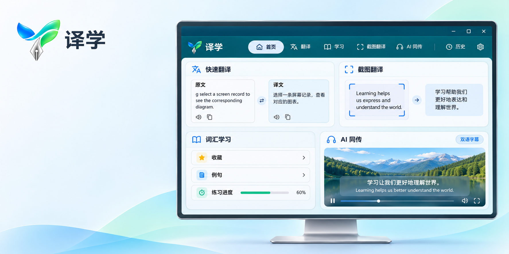
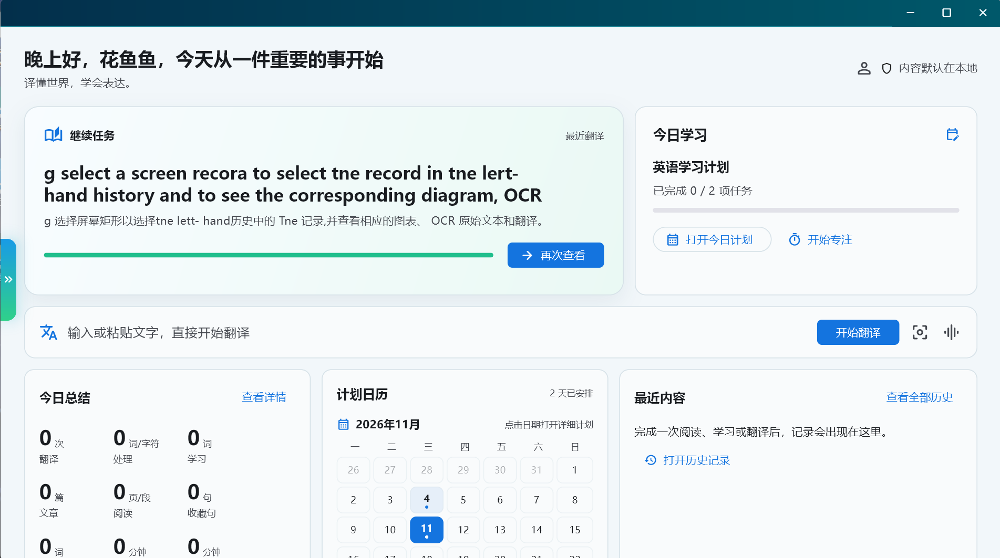
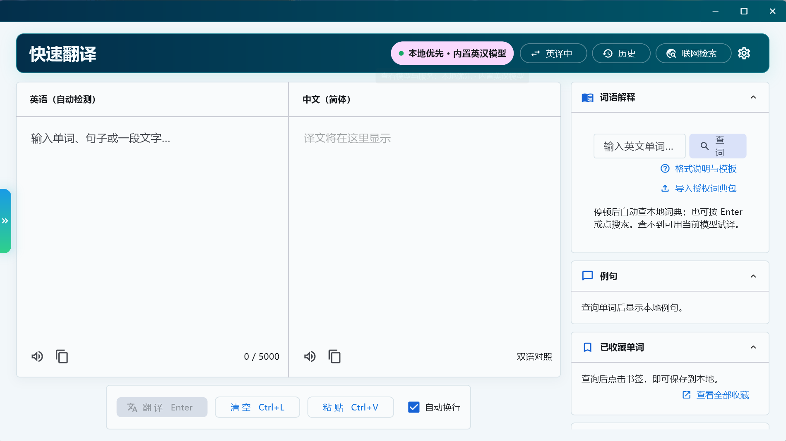
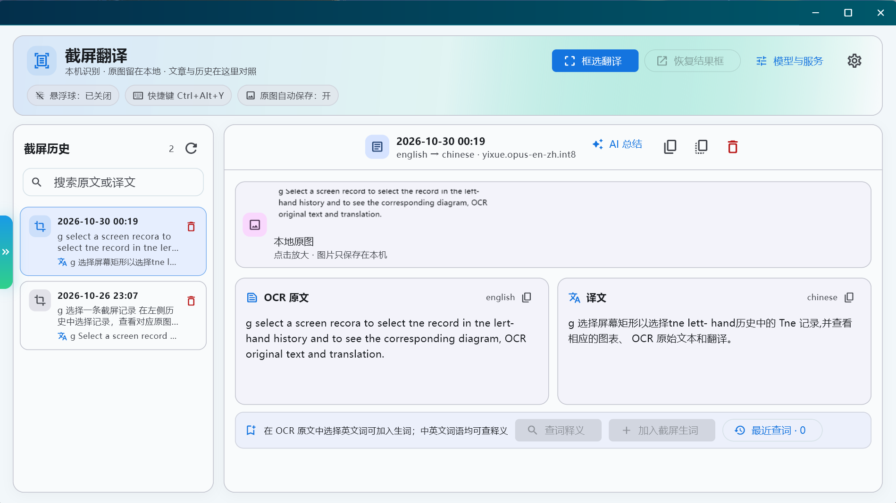
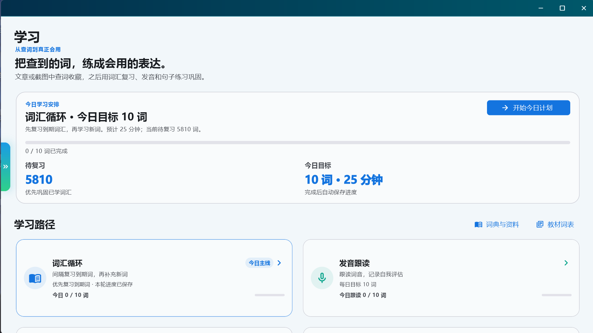
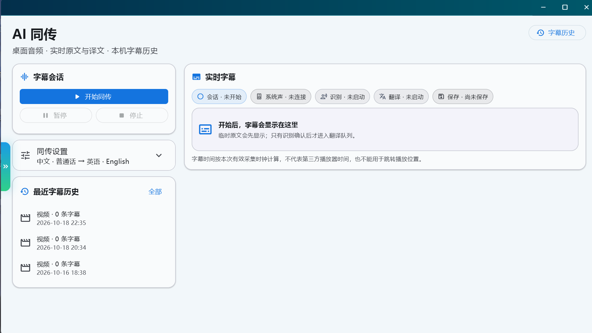

# 译学



**把翻译、查词和语言学习放进一个桌面工作流。**

译学是一款面向 Windows 的桌面翻译与语言学习软件。你可以翻译文字、框选屏幕内容、查词收藏，再把词汇和句子带入学习练习；观看视频或参加线上会议时，也可以尝试用 AI 同传识别桌面声音并查看双语字幕。

<p align="center">
  <a href="https://github.com/sun2006-xin/yixue-desktop/releases/tag/v0.1.0-preview.8"></a>
  <a href="LICENSE"></a>
</p>

> **当前版本：Windows Preview 8。** 横幅是生成式宣传概念图；下方产品图是译学应用界面截图。音频采集、屏幕录制和媒体回放会受 Windows 设备、驱动与素材影响，仍需要在不同电脑上持续验收。

## 译学可以帮你完成什么

### 快速翻译与查词

- 输入单词、句子或较长文本，在中英之间切换方向并查看双语结果。
- Preview 安装包内置英译中和中译英轻量模型，可在本机完成这两个方向的翻译。
- 在词典区域查词，查看可用释义、词性、发音和例句；将词汇加入本地收藏，后续用于学习。
- 通过本机历史回看过去的翻译。需要其他语言或服务时，可配置兼容 OpenAI API 格式的模型服务或已支持的本地模型。

### 截图翻译与屏幕查词

- 使用快捷键或页面按钮框选屏幕区域，识别区域内文字并显示 OCR 原文与译文。
- 保留本地原图，可在结果页查看原图、识别文本和译文，方便逐段核对。
- 在识别结果中选词查释义，或把词汇保存到学习内容中。
- 截图历史记录保留来源、原文和译文，便于重新查看。识别效果会受文字大小、对比度、页面背景和复杂排版影响。

### 语言学习

- 首页汇总继续任务、今日计划、学习统计、计划日历和最近记录。
- 通过词汇循环复习已收藏的词语，并使用发音跟读和句子练习巩固表达。
- 学习文章时可查词、收藏词汇或段落，并保存阅读进度。
- 创建个人句子加入练习；配置兼容模型后，也可按场景生成练习内容。练习结果和学习记录保存在本地资料库。

### AI 实时同传

- 选择电脑系统播放声音或麦克风音源，查看识别状态、原文和翻译结果。
- 可在独立字幕窗中阅读双语字幕，并从本机字幕历史回看会话内容。
- 可选保存音频或录制屏幕；文件默认保存在本机，具体可用性取决于 Windows 音频设备、显卡驱动和媒体编码环境。
- 语音识别路线覆盖英语、中文、日语、韩语、西班牙语、法语、德语、葡萄牙语、俄语及自动识别。识别语言范围不代表每个语言方向都有离线翻译模型。
- 英汉方向提供随包本机翻译模型；其他方向需要相应本地模型或外部翻译服务。歌曲、噪声、多人重叠和远距离收音容易降低识别准确率。

## 应用界面

下方为 Windows 应用界面截图。宣传横幅仅用于介绍产品方向，实际功能状态请以截图和当前 Preview 版本为准。

<table>
  <tr>
    <td width="50%"><p><strong>首页与今日计划</strong><br>查看继续任务、每日学习安排、进度和最近记录。</p></td>
    <td width="50%"><p><strong>快速翻译</strong><br>双栏查看原文与译文，并从词语区域进入查词和收藏。</p></td>
  </tr>
  <tr>
    <td width="50%"><p><strong>截图翻译历史</strong><br>对照本地原图、OCR 原文和译文，并继续查词。</p></td>
    <td width="50%"><p><strong>学习工作台</strong><br>查看复习数量、今日目标和词汇、发音等学习路径。</p></td>
  </tr>
  <tr>
    <td colspan="2"><p><strong>AI 同传</strong><br>查看字幕会话、系统音频状态、翻译状态、设置和最近字幕历史。</p></td>
  </tr>
</table>

## 本机优先与数据说明

- 随包英汉模型在本机运行；收藏、翻译历史、截图记录、学习进度和用户主动保留的媒体文件默认保存在本机。
- 应用资料库与程序文件分开。请勿把个人资料库、录音、字幕或未脱敏日志上传到公开仓库或 Issue。
- 使用外部 API 模型时，输入文本以及服务所需的请求内容会发送给你选择的服务提供方；发送范围由所选服务和当前操作决定。
- 可选在线搜索或云端模型会使用网络。仅安装本地模型并不代表所有功能都离线：不同语言方向、语音识别模型和在线服务的依赖各不相同。

## 下载与安装

1. 从 [GitHub Releases](https://github.com/sun2006-xin/yixue-desktop/releases) 下载 Windows x64 完整压缩包。
2. 将 ZIP 完整解压到新文件夹；请勿只拷贝 `yixue_app.exe`，应用还需要同目录运行库、资源和模型文件。
3. 运行 `yixue_app.exe`。英汉本地翻译模型随包提供；其他语音识别模型可在应用中按需获取。
4. 如需使用外部模型，在模型与服务设置中配置服务地址、模型名称和密钥。使用前请确认服务方的数据处理规则。

当前固定版本：[`v0.1.0-preview.8`](https://github.com/sun2006-xin/yixue-desktop/releases/tag/v0.1.0-preview.8)。

## 从源码构建

需要 Windows、Flutter、Rust MSVC 工具链和 Visual Studio C++ Build Tools。在仓库根目录运行：

```powershell
Set-Location app/yixue_app
../../tool/flutter.ps1 pub get
Set-Location ../..
./tool/build-windows.ps1 -Mode Release
```

构建脚本会检查工具链、可用内存与并发编译进程，并从配置的本地资源目录复制 CTranslate2 运行时和英汉模型。构建本地运行时或模型包前，请阅读 `docs/本地模型包规范.md`、`docs/本地推理运行时规格.md` 和 `docs/第三方运行时许可.md`。

## 项目范围与许可

- 译学原创软件源码使用 [Apache License 2.0](LICENSE)。
- 词典、例句、机器翻译模型、运行时和依赖可能适用不同许可；请阅读 [`THIRD_PARTY_NOTICES.md`](THIRD_PARTY_NOTICES.md) 与压缩包中的 `licenses` 目录。词典数据是来源候选，不等于人工审校过的专业词典。
- 译学名称、标志、品牌图像和应用图标不属于 Apache-2.0 源码许可范围，具体说明见 [`NOTICE`](NOTICE) 与 [`assets/brand/README.md`](assets/brand/README.md)。
- 觅音手机软件在独立仓库和发布流程中维护：[miyin-mobile](https://github.com/sun2006-xin/miyin-mobile)。阅读器也是独立项目，不随译学 Windows 下载包发布。

## 反馈与问题报告

欢迎通过 [GitHub Issues](https://github.com/sun2006-xin/yixue-desktop/issues) 提交问题。请包含复现步骤、译学版本和脱敏后的错误信息；不要上传 API 密钥、个人录音、字幕、屏幕内容或资料库文件。
